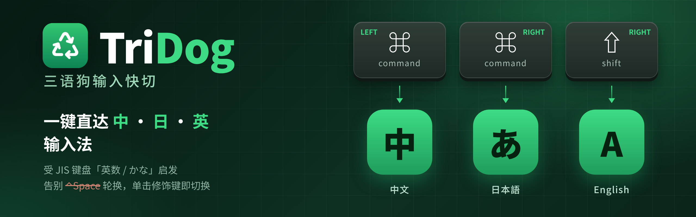
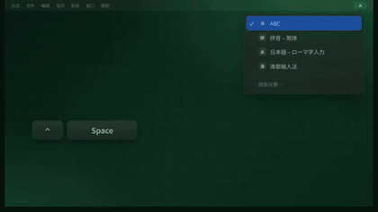

# TriDog (三语狗输入快切)

[中文](README.md) | **English** | [日本語](README.ja.md)





A tiny macOS menu bar app: **tap a modifier key to jump straight to a specific input method**. Made for people who type in Chinese, Japanese and English and are tired of cycling with ⌃Space.

> **Scope: this project is for US-layout keyboards only.** JIS (Japanese) keyboards already have dedicated 英数 / かな keys that switch input methods natively, so they don't need it.

| Tap | Switches to |
|---|---|
| Left ⌘ | A Chinese input method, **your choice from the menu** (default: Qingg / 清歌输入法, or the first available one if Qingg isn't installed) |
| Right ⌘ | Japanese (Romaji) |
| Right ⇧ or Left ⇧ | English (ABC). **Choose Left ⇧ or Right ⇧ in the menu** (default: Right ⇧) |

Only a clean tap counts: press and release with nothing in between. ⌘C, ⌘-click and typing capitals with Shift never trigger a switch.

## What's new in 0.8.0

- **Hide the menu bar icon**: a new menu option removes the ♻ icon from the menu bar while TriDog keeps running in the background. Launch TriDog again to bring it back (see **Menu** below).
- **Improved switching logic**: addresses "I switched to a Chinese input method but it still types English" (see **Known issue** below).
- **Diagnostic log**: an optional log to help track down why an input method doesn't take effect.

## Install

1. Download the latest `TriDog-x.x.x.zip` from [Releases](https://github.com/aoyamashou/TriDog/releases), unzip it, and move `TriDog.app` to Applications.
2. This is a hobby project and is not notarized by Apple, so macOS may block it on first launch. Right-click it and choose **Open**.
   If it still won't open (for example, macOS says it is "damaged"), run this in Terminal to remove the quarantine flag, then open it again:

   ```bash
   xattr -dr com.apple.quarantine /Applications/TriDog.app
   ```

3. Allow TriDog under **System Settings → Privacy & Security → Input Monitoring**.

Requires an Apple Silicon Mac running macOS 13 or later.

## Menu

Click the ♻ icon in the menu bar:

- **Refocus after switching** (off by default): for the situation described under **Known issue** below. With this on, TriDog briefly takes focus for about 30 ms and hands it back, which forces the app to re-read the input method. The trade-off is a short focus flicker, and an open menu or popover may close. Floating-window apps such as Raycast and Tinycast will also close automatically.
- **Launch at Login** (off by default): starts TriDog automatically when you log in. Move the app to Applications before turning this on. If macOS asks for approval, TriDog opens **System Settings → General → Login Items** for you.
- **Hide Menu Bar Icon**: removes the icon from the menu bar while TriDog keeps running in the background. To bring it back, launch TriDog again (from Applications or Launchpad). A manual launch always shows the icon. When TriDog starts automatically at login it tries to stay hidden, but that depends on macOS identifying the launch as a login item and may not work every time. If the icon reappears after login, just choose Hide Menu Bar Icon again. To quit while the icon is hidden, end TriDog in Activity Monitor.
- **Write Diagnostic Log** (off by default): records each switch to `~/Library/Logs/TriDog.log` (only input source IDs and the frontmost app's ID, never what you type). When on, the menu also shows **Mark: Input Just Went Wrong** and **Show Log in Finder**. Click the mark the moment a problem happens so it can be matched against the log.
- **Left ⌘ switches to**: choose from your enabled input methods. English keyboard layouts like ABC and Apple's Japanese input method are not listed.
- **Key for English (ABC)**: Left ⇧ or Right ⇧.
- **About / Quit**

Menu labels follow your system language (Chinese, Japanese, or English).

## Known issue: still typing English after switching to a Chinese input method

**Symptom**: the menu bar already shows the Chinese input method, but what you type is still English until you change focus.

**Cause**: a long-standing macOS problem. After a background process (TriDog included) selects a Chinese, Japanese or Korean input method with `TISSelectInputSource`, the system's "current input source" has changed and the menu bar icon updates, but the focused app's input context (the activation of its `IMKInputController`) is not updated. The app keeps using ABC until focus changes and it re-reads the input method. This mostly happens in Chromium-based apps (Chrome, Electron apps and so on).

**What TriDog does**: since 0.8.0 the switching logic handles this. If the target input method is already current, pressing the same key again makes TriDog switch to ABC and, about 30 ms later, back to the target, which re-activates the input method. In testing, this works with Qingg Wubi (清歌五笔). **Refocus after switching** remains available as a fallback.

**When it can still happen**: Rime-based input methods (for example AIME) share the same layer of macOS glue, the IMK part that handles "being selected, being activated and establishing an input session with the focused app". The problem lives in that layer and TriDog cannot fully work around it from the outside, so it can still occur with Rime-based input methods. If it does, turn on **Write Diagnostic Log** and send the log to the input method's author.

## Tip

If you like one-tap switching, you can turn off the built-in input switching shortcuts so you don't trigger them by accident: open **System Settings → Keyboard → Keyboard Shortcuts… → Input Sources** and uncheck **Select the previous input source** (⌃Space) and **Select next source in Input menu** (⌃⌥Space).

## Different key preferences?

If this layout doesn't suit you (other keys, other input methods), clone this repo and have your AI agent (e.g. Claude Code) change it. All the logic lives in one file, `Sources/main.swift`:

```bash
git clone https://github.com/aoyamashou/TriDog.git
```

## Build from source

Only the Xcode Command Line Tools are needed, not the full Xcode:

```bash
./build.sh
open build/TriDog.app
```

By default `build.sh` signs with an **Apple Development** certificate from your keychain. A fixed certificate means the Input Monitoring permission stays valid across updates, with no need to re-authorize (an ad hoc signature changes with every build). To use another certificate, run `SIGN_IDENTITY="Certificate Name" ./build.sh`. The script stops with an error if no certificate is found.

The Japanese and ABC input source IDs are defined at the top of `Sources/main.swift`. The icon is generated by `Scripts/make-icon.swift`.

## Credits & License

Based on [⌘英かな (cmd-eikana)](https://github.com/iMasanari/cmd-eikana) by iMasanari, via [dominion525's Apple Silicon fork](https://github.com/dominion525/cmd-eikana). Released under the [MIT License](LICENSE), the same as upstream.
