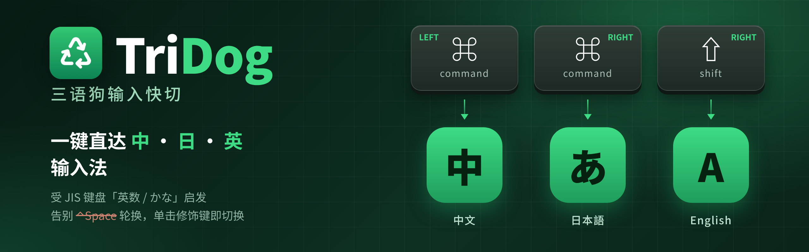
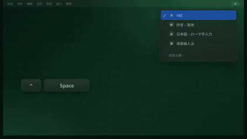

# TriDog（三语狗输入快切）

[中文](README.md) | [English](README.en.md) | **日本語**





macOS のメニューバー常駐アプリです。**修飾キーを単体で押すと、指定した入力ソースに直接切り替わります**。中国語・日本語・英語の 3 言語を使い分ける人向けで、⌃Space で順番に切り替える必要がなくなります。

> **対象：本プロジェクトは US 配列キーボード専用です。** JIS 配列キーボードには「英数」「かな」キーがあり、標準で直接切り替えられるので、本プロジェクトは不要です。

| 単体で押すキー | 切り替え先 |
|---|---|
| 左 ⌘ | 中国語入力ソース。**メニューで自由に選べます**（既定は 清歌输入法。入っていなければ一覧の先頭） |
| 右 ⌘ | 日本語（ローマ字入力） |
| 右 ⇧ または 左 ⇧ | 英語 ABC。**左 ⇧ と右 ⇧ のどちらを使うかメニューで選べます**（既定は右 ⇧） |

押して何もせずに離したときだけ切り替わります。⌘C、⌘ を押しながらのクリック、Shift での大文字入力では切り替わりません。

## 0.8.0 の新機能

- **メニューバーのアイコンを隠す**：メニューに項目を追加しました。クリックするとメニューバーの ♻ アイコンが消え、TriDog はバックグラウンドで動き続けます。もう一度 TriDog を起動すると元に戻ります（下の「メニュー」を参照）。
- **切り替えロジックの改善**：「中国語の入力ソースに切り替えたのに英字のまま入力される」問題に対処しました（下の「既知の問題」を参照）。
- **診断ログ**：入力ソースが反映されない原因を調べるための、任意のログ機能を追加しました。

## ダウンロードとインストール

1. [Releases](https://github.com/aoyamashou/TriDog/releases) から最新の `TriDog-x.x.x.zip` をダウンロードして展開し、`TriDog.app` を「アプリケーション」フォルダに移動します。
2. 初回起動：個人の趣味プロジェクトで Apple の公証を受けていないため、ダブルクリックで開くとブロックされることがあります。右クリック → 開く を選んでください。
   それでも開けない場合（「壊れている」と表示されるなど）は、ターミナルで次のコマンドを実行して隔離属性を外してから、もう一度開いてください。

   ```bash
   xattr -dr com.apple.quarantine /Applications/TriDog.app
   ```

3. 「システム設定 → プライバシーとセキュリティ → 入力監視」で TriDog を許可します。

動作環境：Apple Silicon Mac、macOS 13 以降。

## メニュー

メニューバーの ♻ アイコンをクリックすると、次の項目があります。

- **切り替え後にフォーカスを更新**（既定はオフ）：下の「既知の問題」で説明している状況への備えです。オンにすると、切り替え時にフォーカスを約 30ms だけ外して戻し、アプリに入力ソースを読み直させます。その代わりフォーカスが一瞬ちらつき、開いているメニューやポップオーバーが閉じることがあります。Raycast や Tinycast のようなフローティングウィンドウのアプリも自動で閉じてしまいます。
- **ログイン時に起動**（既定はオフ）：オンにすると、macOS へのログイン時に TriDog を自動で起動します。先にアプリを「アプリケーション」フォルダに移してからオンにしてください。承認が必要な場合は「システム設定 → 一般 → ログイン項目」が自動で開きます。
- **メニューバーのアイコンを隠す**：クリックするとメニューバーのアイコンが消え、TriDog はバックグラウンドで動き続けます。元に戻すには、もう一度 TriDog を起動してください（「アプリケーション」や Launchpad から）。手動で起動したときは必ずアイコンが表示されます。ログイン時の自動起動では隠したままにしようとしますが、macOS がログイン項目としての起動だと判断するかどうかに依存するため、毎回効くとは限りません。ログイン後にアイコンが再び表示されたときは、もう一度「メニューバーのアイコンを隠す」を選んでください。アイコンを隠している間に終了したいときは、「アクティビティモニタ」で TriDog を終了してください。
- **診断ログを記録**（既定はオフ）：オンにすると、切り替えのたびに `~/Library/Logs/TriDog.log` へ記録します（記録するのは入力ソースと前面アプリの ID だけで、入力した内容は記録しません）。オンの間はメニューに「印を付ける：今、入力がおかしい」と「ログを Finder で表示」も表示されます。問題が起きた瞬間に印を付けておくと、ログと突き合わせられます。
- **左 ⌘ の切り替え先**：有効な入力ソースから選びます。ABC などの英語キーボードと Apple の日本語入力は一覧に出ません。
- **英語 (ABC) に切り替えるキー**：左 ⇧ か右 ⇧ を選びます。
- **について / 終了**

メニューはシステムの言語（中国語・日本語・英語）に合わせて表示されます。

## 既知の問題：中国語の入力ソースに切り替えても英字のまま入力される

**症状**：キーを押してメニューバーは中国語の入力ソースになっているのに、実際には英字のまま入力され、フォーカスを切り替えると直ります。

**原因**：macOS の古い不具合です。バックグラウンドのプロセス（TriDog を含む）が `TISSelectInputSource` で中国語・日本語・韓国語の入力ソースを選ぶと、システムの「現在の入力ソース」は変わりメニューバーのアイコンも変わりますが、前面アプリの入力コンテキスト（`IMKInputController` の有効化）は更新されません。アプリは ABC のままで、フォーカスを切り替えて読み直したときに初めて反映されます。主に Chromium ベースのアプリ（Chrome や Electron アプリなど）で起こります。

**TriDog の対処**：0.8.0 から切り替えロジックで対処しています。すでに目的の入力ソースになっているときに同じキーをもう一度押すと、TriDog はいったん ABC に切り替え、約 30ms 後に目的の入力ソースへ戻して、入力ソースを再度有効化します。テストでは、清歌五筆（Qingg Wubi）でこの方法が有効でした。「切り替え後にフォーカスを更新」も予備の手段として残してあります。

**それでも起こる場合**：Rime 系の入力ソース（たとえば AIME）は、macOS 側の同じ層、つまり「選ばれる、有効化される、前面アプリと入力セッションを結ぶ」を担当する IMK の部分を共有しています。問題はこの層にあり、TriDog が外側から完全に回避することはできないため、Rime 系の入力ソースでは起こることがあります。起きたときは「診断ログを記録」をオンにして、ログを入力ソースの作者に伝えてください。

## ちょっとしたコツ

ワンタップ切り替えが気に入ったら、誤って押さないように macOS 標準の切り替えショートカットをオフにしておくのがおすすめです。「システム設定 → キーボード → キーボードショートカット… → 入力ソース」で、「前の入力ソースを選択」（⌃Space）と「入力メニューの次のソースを選択」（⌃⌥Space）のチェックを外します。

## キー配置が合わないときは

このキー配置が合わない場合（別のキーを使いたい、別の入力ソースに切り替えたいなど）は、このリポジトリをクローンして、お使いの AI エージェント（Claude Code など）に書き換えてもらってください。処理はすべて `Sources/main.swift` の 1 ファイルにまとまっています。

```bash
git clone https://github.com/aoyamashou/TriDog.git
```

## ソースからビルド

Xcode 本体は不要で、Xcode Command Line Tools だけでビルドできます。

```bash
./build.sh
open build/TriDog.app
```

`build.sh` は、既定でキーチェーンの **Apple Development** 証明書で署名します。固定の証明書で署名すると、バージョンを更新しても「入力監視」の許可が無効にならず、許可し直す必要がありません（ad hoc 署名ではビルドのたびに署名が変わります）。別の証明書を使うときは `SIGN_IDENTITY="証明書の名前" ./build.sh` を実行してください。証明書が見つからないときはエラーで止まります。

日本語と ABC の入力ソース ID は `Sources/main.swift` の先頭で定義しています。アイコンは `Scripts/make-icon.swift` で生成しています。

## クレジットとライセンス

iMasanari さんの [⌘英かな](https://github.com/iMasanari/cmd-eikana) と、[dominion525 さんの Apple Silicon フォーク版](https://github.com/dominion525/cmd-eikana) をもとに作り直したものです。ライセンスは上流と同じ [MIT License](LICENSE) です。
