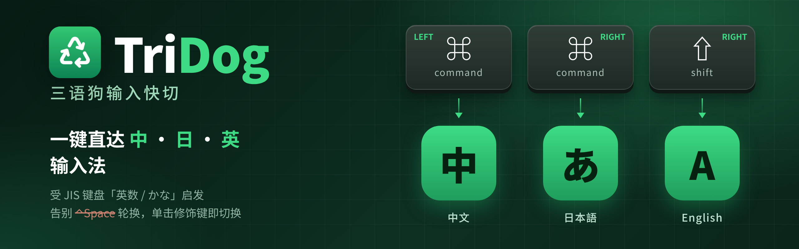
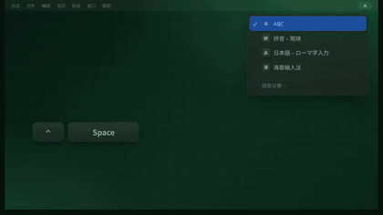

# 三语狗输入快切 TriDog

**中文** | [English](README.en.md) | [日本語](README.ja.md)





一个 macOS 菜单栏小工具：**单击修饰键，直接切换到指定输入法**。适合同时使用中文、日语、英语三种输入法的人，不用再反复按 ⌃Space 轮换。

> **适用范围：** 修饰键单击切换适用于任何布局的键盘。JIS 配列（日式布局）键盘还可以把空格两边的「英数」「かな」键改成切换到任意输入法（0.9.0 起，见下方）。

| 单击 | 切换到 |
|---|---|
| 左 ⌘ | 中文输入法，**可在菜单中自己选择**（默认清歌输入法；没装清歌时自动用列表里的第一个） |
| 右 ⌘ | 日语（罗马字输入） |
| 右 ⇧ 或 左 ⇧ | 英语 ABC，**可在菜单中自己选择用左 ⇧ 还是右 ⇧**（默认右 ⇧） |

只有「按下后什么都没做就松开」才算单击。⌘C、⌘ 加鼠标点击、用 Shift 输入大写字母都不会触发切换。

## 0.9.0 新功能

- **JIS 键盘的「英数」「かな」键可以自定义**：在菜单里分别给这两个键选择切换目标（ABC、日语或任意已启用的输入法），比如让「かな」直接切到中文。默认是「不接管」，保持系统原本的行为。
  - 需要额外授予「辅助功能」权限：TriDog 必须拦下这次按键，否则系统自己的切换会和 TriDog 抢，结果不确定。只有在你给某个键选了目标后才会请求这个权限。
  - 带 ⌘、⌃、⌥、⇧ 的组合（如 ⌘+かな）不会被接管，仍交给系统和应用处理。
  - 部分外接 JIS 键盘（如罗技 MX Mechanical）在 Mac 模式下，「かな」右边的「カタカナ/ひらがな/ローマ字」键不会向系统发送任何信号，TriDog 无法使用这个键。

## 0.8.0 新功能

- **隐藏菜单栏图标**：菜单里新增一个选项，点击后菜单栏的 ♻ 图标就会消失，程序继续在后台工作。想让图标回来，再启动一次 TriDog 即可（见下方「菜单选项」）。
- **改进切换逻辑**：针对「切到中文输入法后仍然输入英文」的问题做了处理（见下方「已知问题」）。
- **诊断日志**：新增可选的日志功能，方便排查输入法不生效的原因。

## 下载与安装

1. 从 [Releases](https://github.com/aoyamashou/TriDog/releases) 下载最新的 `TriDog-x.x.x.zip`，解压后把 `TriDog.app` 拖到「应用程序」文件夹。
2. 首次打开：这是个人业余小项目，没有付费做苹果公证，双击时可能会被系统拦截。请右键点击 → 打开。
   如果仍然打不开（例如提示「已损坏」），在终端里运行下面的命令解除隔离，然后再打开：

   ```bash
   xattr -dr com.apple.quarantine /Applications/TriDog.app
   ```

3. 在「系统设置 → 隐私与安全性 → 输入监控」里允许 TriDog。如果要用 JIS 键盘的「英数」「かな」键，还需要在「辅助功能」里允许 TriDog（选择切换目标时会自动弹出提示）。

运行要求：Apple Silicon Mac，macOS 13 或更新。

## 菜单选项

点击菜单栏的 ♻ 图标：

- **切换后刷新焦点**（默认关闭）：用于下面「已知问题」里的情况。打开后，切换时焦点会离开当前窗口约 30ms 再回来，强制当前应用重新读取输入法。代价是焦点会闪一下，开着的菜单或弹出框可能被关掉；Raycast、Tinycast 这类浮窗软件也会因此自动关闭。
- **开机自动启动**（默认关闭）：打开后，登录 macOS 时自动启动 TriDog。建议先把 App 放进「应用程序」文件夹再打开这个选项。如果系统要求确认，会自动打开「系统设置 → 通用 → 登录项」。
- **隐藏菜单栏图标**：点击后菜单栏图标消失，程序继续在后台工作。想让图标回来，再启动一次 TriDog（在「应用程序」或 Launchpad 里打开）即可。手动启动时一定会显示图标；开机自动启动时会尽量保持隐藏，但这一点取决于系统是否把这次启动识别为登录项，不一定每次都生效。如果开机后图标又出现了，再点一次「隐藏菜单栏图标」即可。图标隐藏期间如果想退出，请在「活动监视器」里结束 TriDog。
- **记录诊断日志**（默认关闭）：打开后，每次切换的情况会记录到 `~/Library/Logs/TriDog.log`（只记录输入源和前台应用的 ID，不记录你输入的内容）。打开后菜单里还会出现「标记：刚才输入异常」和「在访达中显示日志」，遇到问题时点一下标记，方便对照日志排查。
- **左 ⌘ 切换到**：从已启用的输入法中选择。列表不包含 ABC 等英文键盘和苹果自带的日语输入法。
- **切换英文 (ABC) 的按键**：选择左 ⇧ 或右 ⇧。
- **JIS「英数」键切换到 / JIS「かな」键切换到**：分别选择「不接管（系统默认）」、ABC、日语或已启用的输入法。没有授予「辅助功能」时，菜单顶部会显示警告和打开设置的入口；授权后几秒内自动生效，不用重启。
- **关于 / 退出**

## 已知问题：切换到中文输入法后仍然输入英文

**现象**：按键后菜单栏已经显示中文输入法，但实际打出来的仍然是英文，要切换一下焦点才恢复。

**原因**：这是 macOS 的老问题。后台程序（包括 TriDog）调用 `TISSelectInputSource` 选中中日韩输入法后，系统的「当前输入源」已经变了，菜单栏图标也会变，但前台应用的输入上下文（`IMKInputController` 的激活）没有跟着更新，应用还在用 ABC，要切换焦点才会重新读取。这个问题通常发生在基于 Chromium 的应用（Chrome、Electron 应用等）上。

**TriDog 的处理**：从 0.8.0 起，切换逻辑针对这一点做了改进。当前已经是目标输入法时，再按一次同一个键，TriDog 会先切到 ABC，约 30ms 后再切回目标输入法，重新激活输入法。经测试，在清歌五笔下这样做有效。另外还保留了「切换后刷新焦点」作为备用手段。

**仍然存在的情况**：Rime 系输入法（例如 AIME）共用同一层 macOS 外壳，也就是处理「被选中、被激活、和前台应用建立输入会话」的 IMK 部分。问题出在这一层，TriDog 在外部无法完全绕过，所以使用 Rime 系输入法时问题仍可能出现。遇到时可以打开「记录诊断日志」，把日志反馈给输入法的作者。

## 小建议

如果觉得一键切换好用，可以把系统自带的切换输入法快捷键取消掉，免得误触：打开「系统设置 → 键盘 → 键盘快捷键… → 输入法」，取消勾选「选择上一个输入法」（⌃Space）和「选择输入法菜单中的下一个输入法」（⌃⌥Space）。

## 键位不合习惯？

如果这套键位不符合你的习惯（比如想用别的键，或者想切到别的输入法），请自行克隆本仓库，让你的 AI agent（如 Claude Code）去改。所有逻辑都在一个文件 `Sources/main.swift` 里，改起来很简单：

```bash
git clone https://github.com/aoyamashou/TriDog.git
```

## 从源代码构建

只需要 Xcode Command Line Tools，不需要装 Xcode：

```bash
./build.sh
open build/TriDog.app
```

`build.sh` 默认使用钥匙串里的 **Apple Development** 证书签名。使用固定证书的好处是：更新版本后，「输入监控」的授权不会失效，不用重新授权（如果用 ad hoc 签名，每次构建签名都会变）。想用别的证书，运行 `SIGN_IDENTITY="证书名称" ./build.sh`；找不到证书时会直接报错。

日语和 ABC 的输入法 ID 写在 `Sources/main.swift` 顶部。图标由 `Scripts/make-icon.swift` 生成。

## 友情项目

这两个项目的作者在输入法和 Claude 模型使用方面给了我非常多的指导，大家有兴趣也可以看看他们的项目：

- [水杉输入法 MSIME](https://github.com/metasequoiaime/msime)：开源的多平台中文输入法，支持 Android、iOS、macOS、Linux、Windows 和 HarmonyOS，各平台共用同一套 Rust 输入引擎。
- [QDuo](https://github.com/XueshiQiao/qduo)：macOS 划词工具，在任意 App 里选中文字，光标旁就会弹出你自定义的操作（翻译、润色、搜索、朗读、问 AI 等），结果直接写回原处。

## 致谢与许可

基于 iMasanari 的 [⌘英かな](https://github.com/iMasanari/cmd-eikana)（及 [dominion525 的 Apple Silicon 分支](https://github.com/dominion525/cmd-eikana)）改造。采用与上游一致的 [MIT License](LICENSE)。
